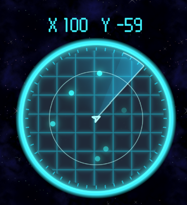

# Galaxy.io

> 우주를 떠돌며 적을 격추하고, 재료를 모아 더 큰 함선으로 성장하는 **실시간 멀티플레이 우주 함선 슈팅 게임**


---

## 🎮 게임 소개

Galaxy.io 는 하나의 넓은 우주 맵에 여러 플레이어가 동시에 접속해 **파밍 → 성장 → 전투**를 반복하는 io 스타일 게임입니다.
작은 초계함으로 시작해 AI 적을 잡고 재료를 모은 뒤, 포탑을 바꾸고 함선을 강화하며 결국 순양함과 모선까지 성장합니다.
죽으면 점수를 모두 잃고 들고 있던 재료를 떨어뜨리므로, 다른 플레이어에게는 그 자체가 노려볼 만한 먹잇감이 됩니다.

### 🌐 멀티플레이

- **서버 권한(Server-Authoritative) 실시간 멀티플레이**: 서버 접속, 직접 호스팅, 데디케이티드 서버 모두 지원
- **파티 시스템**: 채팅 명령어(`/p inv`, `kick`, `delegate` 등) 또는 닉네임 메뉴로 초대·추방·위임
  - 파티원끼리는 투사체·폭발 피해 없음, 초록 외곽선과 레이더 실시간 위치로 서로를 확인
- **소통 도구**
  - 전체 / 파티 / 귓속말 채팅과 우주선 위 말풍선
  - **핑**: 우주선·적·아이템·목적지에 표시를 찍어 파티원에게 공유 (화면 밖은 가장자리 화살표)
  - 킬로그(아군/적 색 구분), 실시간 스코어보드
- **맵(레이더)**
  - 실시간으로 적의 위치를 보여주지 않고, 주기적으로 회전하는 스캐너에 의해 스캔될 시에만 보여줌. 아군(파티원)은 초록,
    AI가 조종하는 봇 유닛은 하늘, 적대적 플레이어는 주황색 점으로 표시.



### ⛏️ 파밍 & 성장


- 주기적으로 스폰되는 **AI 적 함선**을 격추하면 드랍 테이블에 따라 재료가 떨어짐
- **재료(화폐)**: 파워 셀 / 과충전 파워 셀 / 반응로
- 모은 재료로
  - **포탑 상점**에서 포탑 구매·장착 — Bore, Brakkar, Pyron, Raptor, Veylance, Vraxx
  - **함선 상점**에서 상위 기종 구매
  - **강화 창**에서 기종별 능력치 강화 — 피해, 최대 열, 재장전, 체력, 수리, 속도, 기동, 레이더 범위/속도, 함재기 증원/생산성 등
  - 상점은 `E`키를 눌러 열 수 있음


### ⚔️ 전투


함선은 4개 함급, 총 10종으로 나뉘며 함급마다 플레이 방식이 크게 다릅니다.

| 함급                  | 기종                           | 특징                                                              |
|---------------------|------------------------------|-----------------------------------------------------------------|
| **초계함** (Corvette)  | Vex, Vulture, Nighthawk      | 빠르고 가벼움. 핑으로 목표를 지정하는 정찰 역할, 고속 시 함선 충돌 무시                      |
| **호위함** (Frigate)   | Vanguard, Sentinel, Halberd  | 쌍포신 포탑, 균형 잡힌 교전형                                               |
| **순양함** (Cruiser)   | Leviathan, Paladin           | 전방 고정 함포 + 자동 포탑. Leviathan 은 반동이 큰 연사 함포, Paladin 은 3초 충전 관통포  |
| **모선** (Carrier)    | Colossus, Behemoth           | 함재기를 생산·출격시켜 공격 / 지역 확보 / 호위 / 귀환 명령                            |

- **열(Heat) 관리**: 휴식 없이 터렛을 마구잡이로 쏘면 포탑이 과열되므로 게이지 관리 능력이 요구됨
- **관성 비행**: 가속·감속, 선회 제동, 회전 관성이 있는 우주선 조작
- **충돌 피해**: 선체 두께에 따라 충돌 반발과 피해가 달라짐
- **막타 + 어시스트** 기반 점수, 사망 시 점수 초기화


---

## 🛠️ 기술 스택

| 분류 | 사용 기술 |
|---|---|
| 엔진 | **Unity 6** (6000.3), URP 2D |
| 게임플레이 | **Unity DOTS** — Entities 1.4, Burst, Jobs, Collections, Mathematics |
| 네트워크 | **Netcode for Entities** 1.14 (서버 권한, 클라이언트 예측, 고스트 복제) |
| 서버 | Unity Dedicated Server |
| 렌더링 | Entities Graphics, 커스텀 셰이더 (외곽선, 충격파 왜곡, 핑 UI 등) |
| UI / 기타 | uGUI + TextMeshPro, Input System, Localization (한/영), Addressables, Cinemachine, DOTween |

### DOTS 구조


- **ECS 기반 시뮬레이션**: 이동, 사격, 충돌, AI, 아이템, 파티, 함재기 등 게임 로직 전체를 `ISystem` + Burst 로 처리
- **서버 / 클라이언트 월드 분리**: 서버가 판정하고, 클라이언트는 입력 전송과 연출만 담당
- **고스트 Relevancy**: 각 플레이어의 레이더 반경 안에 있는 엔티티만 복제해 대역폭 절약
- **자체 충돌 시스템**: Unity Physics 대신 공간 해시(Spatial Hash) + AABB 로 2D 충돌을 직접 구현
- **RPC 메시지**: 채팅, 파티, 핑, 구매, 강화, 함재기 명령 등은 `IRpcCommand` 로 주고받음
- **Hybrid 연출**: 사운드, UI, 이름표, 체력바 등은 Managed(MonoBehaviour) 쪽에서 ECS 데이터를 읽어 표시

```
Assets/GalaxyIO/Scripts
├── DOTS
│   ├── Authoring     # 프리팹/설정 → 엔티티 베이킹
│   ├── Components    # 컴포넌트, RPC, 싱글톤
│   ├── Systems       # 서버/공용 시스템 (전투, AI, 아이템, 파티, 함재기 …)
│   ├── Client        # 클라이언트 전용 시스템 (입력, 연출, 예측 투사체)
│   ├── Collision     # 공간 해시 기반 충돌
│   └── Networking    # 부트스트랩, 세션, 드라이버
└── Managed           # UI, 채팅, 사운드, 카메라, 씬 관리
```

---

## 🚀 실행 방법

1. Unity **6000.3.21f1** 로 프로젝트 열기
2. `Assets/GalaxyIO/Scenes/GalaxyIO_Lobby.unity` 실행
3. 로비에서 **Host Server**로 서버를 열거나, **Connect to Server** -> **Private Server**에서 서버 주소를 입력해 **Start Game**

> 에디터에서 여러 클라이언트를 테스트할 때는 **Multiplayer Play Mode** 를 사용합니다.

